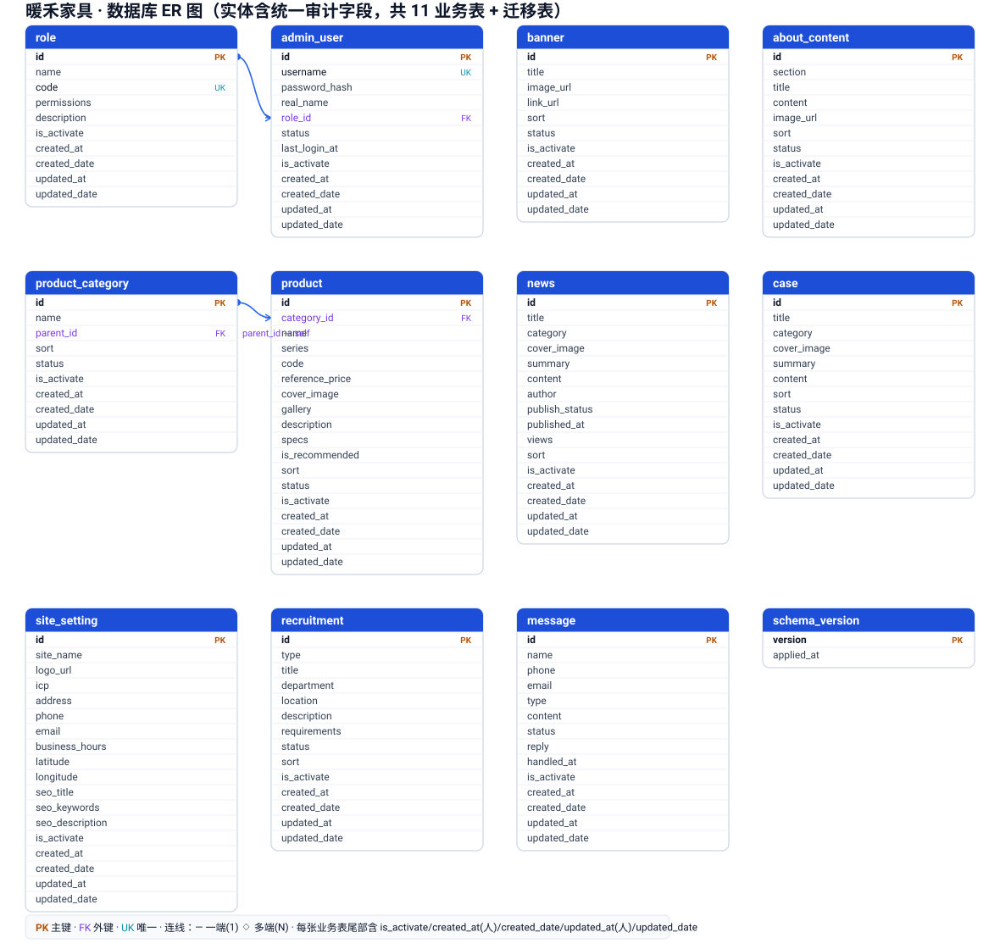

# 暖禾家具 · 数据库设计文档

> **文档状态**：开发基线（供 `api/` 后端落地参考）
> **版本**：v1.1
> **创建日期**：2026-08-25
> **更新日期**：2026-08-25
> **依据文档**：`企业家居网站PRD.md`（v1.2）、`暖禾-开发技术文档.md`（v1.0）
> **配套图形**：`暖禾-er-diagram.svg`（ER 图，由脚本生成）
> **适用范围**：`api/`（后端 Api 服务，FastAPI + SQLite）
> **交付形态**：单文件数据库设计文档（ER 图 + 数据字典 + 建表 DDL），不含完整工程代码

---

## 0. 文档信息

| 项目 | 内容 |
| --- | --- |
| 文档类型 | 数据库设计文档（DDD） |
| 目标读者 | 后端工程师、DBA、技术负责人 |
| 上游需求 | PRD v1.2（第 6 章数据库基线） |
| 上游技术 | 开发技术文档 v1.0（第 3 章建表 SQL / 模型 / 种子数据） |
| 引擎 | SQLite（文件库 `api/app.db`，零运维） |
| 表数量 | 11 张业务表 + 1 张迁移版本表（共 12） |

---

## 1. 概述与设计约定

### 1.1 数据库概况
- **引擎**：SQLite 3。文件位于 `api/app.db`，由 `init.sql` 初始化，由 SQLAlchemy 模型映射。
- **字符集**：UTF-8（SQLite 默认，文本统一以 UTF-8 存储）。
- **命名规范**：
  - 表名、字段名一律 **蛇形小写**（snake_case），如 `product_category`、`reference_price`。
  - 主键统一命名为 `id`，自增 `INTEGER PRIMARY KEY AUTOINCREMENT`。
  - 外键字段命名 `<关联表单数>_id`，如 `role_id`、`category_id`。
  - 时间字段统一 `created_date` / `updated_date` / `published_at` 等，类型 `DATETIME`，默认 `CURRENT_TIMESTAMP`；人员字段统一 `created_at` / `updated_at` 存创建人 / 修改人（TEXT）。
- **类型映射**：SQLite 动态类型，本文约定逻辑类型 → 物理存储：
  - 整数（`INTEGER`）：自增主键、状态位、计数、外键。
  - 文本（`TEXT`）：名称、描述、富文本 HTML、JSON 串、枚举值、人员账号。
  - 实数（`REAL`）：价格、经纬度。
  - 日期时间（`DATETIME`）：按 ISO8601 字符串或 SQLite `CURRENT_TIMESTAMP` 存储。

### 1.2 通用约定
- **统一审计字段（v1.1 新增）**：每张 **业务表** 尾部统一包含 5 个审计/状态字段：
  `is_activate`（激活/禁用）、`created_at`（创建人）、`created_date`（创建时间）、`updated_at`（修改人）、`updated_date`（修改时间）。
  - 旧版 `banner/product/news/case/recruitment` 原有的 `created_at`/`updated_at` **时间戳已重命名为 `created_date`/`updated_date`**；`admin_user`/`message` 原有的 `created_at` 时间戳同样并入 `created_date`。
  - 迁移版本表 `schema_version` 为系统内部表，**不加**审计字段。
- **软状态而非硬删除**：内容表（`banner`/`product`/`news`/`case`/`recruitment`/`about_content`/`product_category`）除审计 `is_activate` 外，仍用 `status` 字段标记启用/禁用/上下架，**不物理删除**（除非后台显式删除且无关联）。
- **JSON 存储**：`role.permissions`、`product.gallery` 等以 **JSON 字符串** 存于 `TEXT`，由后端（Api）序列化/反序列化。
- **富文本**：`content` / `description` / `requirements` 等存 TipTap 输出的 **HTML 文本**，入库前经后端（Api）白名单清洗（见技术文档 4.5）。
- **枚举约束**：状态类字段用 `INTEGER` 或 `TEXT` 枚举（见 1.3），业务语义由后端（Api）校验。

### 1.3 状态/枚举取值字典
| 字段 | 表 | 取值 | 含义 |
| --- | --- | --- | --- |
| `role.code` | role | super_admin / editor / operator | 超级管理员 / 内容编辑 / 运营 |
| `admin_user.status` | admin_user | 1 / 0 | 启用 / 禁用 |
| `is_activate` | 全部 11 业务表 | 1 / 0 | 激活 / 禁用 |
| `banner.status` | banner | 1 / 0 | 启用 / 停用 |
| `product_category.status` | product_category | 1 / 0 | 启用 / 禁用 |
| `product.is_recommended` | product | 1 / 0 | 首页推荐 / 否 |
| `product.status` | product | 1 / 0 | 上架 / 下架 |
| `news.category` | news | 企业新闻 / 行业资讯 | （TEXT 枚举） |
| `news.publish_status` | news | 1 / 0 | 已发布 / 草稿 |
| `case.category` | case | 项目案例 / 客户案例（可空） | |
| `case.status` | case | 1 / 0 | 启用 / 停用 |
| `recruitment.type` | recruitment | 1 / 2 | 社会招聘 / 校园招聘 |
| `recruitment.status` | recruitment | 1 / 0 | 招聘中 / 停用 |
| `message.type` | message | 留言 / 预约 / 咨询 / 简历投递 | （TEXT 枚举） |
| `message.status` | message | 0 / 1 / 2 | 待处理 / 已处理 / 已忽略 |
| `about_content.section` | about_content | about_暖禾 / history / brand | 关于暖禾 / 发展历程 / 品牌介绍 |

---

## 2. ER 图

整体实体关系图如下（由 `暖禾-er-diagram.svg` 生成，含 PK/FK/UK 标记与连线；每个业务表尾部统一含 5 个审计字段）：



### 2.1 关系说明
- **`admin_user.role_id` → `role.id`**（多对一）：一名管理员归属一个角色；一个角色可被多名管理员引用。FK 位于 `admin_user` 侧（多端），PK 位于 `role` 侧（一端）。
- **`product.category_id` → `product_category.id`**（多对一）：一个产品归属一个分类；一个分类下可有多个产品。删除分类前须校验无关联产品（见技术文档 4.6）。
- **`product_category.parent_id` → `product_category.id`**（自引用一对多）：支持二级分类，一级分类 `parent_id` 为 `NULL`。
- 其余表（`banner` / `site_setting` / `about_content` / `news` / `case` / `recruitment` / `message`）为相对独立的 **内容/互动表**，彼此无外键关联。
- `schema_version` 为 **迁移版本表**，不参与业务关系，也不含审计字段。

---

## 3. 数据字典（逐表）

> 字段约束缩写：PK=主键，FK=外键，UK=唯一，NN=非空，NULL=可空，AI=自增。
> 业务表统一审计字段（尾部）：`is_activate`(INTEGER,1激活/0禁用,默认1)、`created_at`(TEXT,创建人,可空)、`created_date`(DATETIME,创建时间,默认now)、`updated_at`(TEXT,修改人,可空)、`updated_date`(DATETIME,修改时间,可空)。

### 3.1 role（角色）
| 字段 | 类型 | 约束 | 默认 | 说明 |
| --- | --- | --- | --- | --- |
| id | INTEGER | PK, AI | — | 角色 ID |
| name | TEXT(50) | NN | — | 角色名（中文，如 超级管理员） |
| code | TEXT(50) | NN, UK | — | 角色代码：super_admin / editor / operator |
| permissions | TEXT | NN | '[]' | 权限键 JSON 数组，如 `["banner","product"]`；`["*"]` 表示全部 |
| description | TEXT | NULL | NULL | 角色说明 |
| is_activate | INTEGER | NN | 1 | 1 激活 / 0 禁用 |
| created_at | TEXT | NULL | NULL | 创建人（登录账号） |
| created_date | DATETIME | — | now | 创建时间 |
| updated_at | TEXT | NULL | NULL | 修改人 |
| updated_date | DATETIME | NULL | NULL | 修改时间 |

### 3.2 admin_user（管理员）
| 字段 | 类型 | 约束 | 默认 | 说明 |
| --- | --- | --- | --- | --- |
| id | INTEGER | PK, AI | — | 管理员 ID |
| username | TEXT(50) | NN, UK | — | 登录账号 |
| password_hash | TEXT(255) | NN | — | bcrypt 哈希，禁止明文 |
| real_name | TEXT(50) | NULL | NULL | 真实姓名 |
| role_id | INTEGER | NN, FK→role(id) | — | 所属角色 |
| status | INTEGER | NN | 1 | 1 启用 / 0 禁用 |
| last_login_at | DATETIME | NULL | NULL | 最后登录时间 |
| is_activate | INTEGER | NN | 1 | 1 激活 / 0 禁用 |
| created_at | TEXT | NULL | NULL | 创建人 |
| created_date | DATETIME | — | now | 创建时间（由原 created_at 时间戳更名） |
| updated_at | TEXT | NULL | NULL | 修改人 |
| updated_date | DATETIME | NULL | NULL | 修改时间 |

### 3.3 banner（轮播图）
| 字段 | 类型 | 约束 | 默认 | 说明 |
| --- | --- | --- | --- | --- |
| id | INTEGER | PK, AI | — | ID |
| title | TEXT(100) | NULL | NULL | 标题 |
| image_url | TEXT(255) | NULL | NULL | 图片地址 |
| link_url | TEXT(255) | NULL | NULL | 点击跳转链接 |
| sort | INTEGER | NN | 0 | 排序，升序展示 |
| status | INTEGER | NN | 1 | 1 启用 / 0 停用 |
| is_activate | INTEGER | NN | 1 | 1 激活 / 0 禁用 |
| created_at | TEXT | NULL | NULL | 创建人 |
| created_date | DATETIME | — | now | 创建时间（由原 created_at 时间戳更名） |
| updated_at | TEXT | NULL | NULL | 修改人 |
| updated_date | DATETIME | NULL | NULL | 修改时间（由原 updated_at 时间戳更名） |

### 3.4 site_setting（站点设置，单条）
| 字段 | 类型 | 约束 | 默认 | 说明 |
| --- | --- | --- | --- | --- |
| id | INTEGER | PK, CHECK(id=1) | 1 | 固定为 1 的单条记录 |
| site_name | TEXT(100) | NULL | NULL | 站点名称 |
| logo_url | TEXT(255) | NULL | NULL | Logo 地址 |
| icp | TEXT(50) | NULL | NULL | 备案号 |
| address | TEXT(255) | NULL | NULL | 公司地址 |
| phone | TEXT(50) | NULL | NULL | 联系电话 |
| email | TEXT(100) | NULL | NULL | 联系邮箱 |
| business_hours | TEXT(100) | NULL | NULL | 营业时间 |
| latitude | REAL | NULL | NULL | 地图纬度 |
| longitude | REAL | NULL | NULL | 地图经度 |
| seo_title | TEXT(255) | NULL | NULL | SEO 标题 |
| seo_keywords | TEXT(255) | NULL | NULL | SEO 关键词 |
| seo_description | TEXT(255) | NULL | NULL | SEO 描述 |
| is_activate | INTEGER | NN | 1 | 1 激活 / 0 禁用 |
| created_at | TEXT | NULL | NULL | 创建人 |
| created_date | DATETIME | — | now | 创建时间 |
| updated_at | TEXT | NULL | NULL | 修改人 |
| updated_date | DATETIME | NULL | NULL | 修改时间 |

> 前台「联系我们」的地址/电话/邮箱/营业时间/地图经纬度均从此表读取，由后台（Backend）「站点设置」模块维护。

### 3.5 about_content（关于我们内容）
| 字段 | 类型 | 约束 | 默认 | 说明 |
| --- | --- | --- | --- | --- |
| id | INTEGER | PK, AI | — | ID |
| section | TEXT(50) | NN | — | 板块：about_暖禾 / history / brand |
| title | TEXT(100) | NULL | NULL | 标题 |
| content | TEXT | NULL | NULL | 正文（富文本 HTML） |
| image_url | TEXT(255) | NULL | NULL | 配图 |
| sort | INTEGER | NN | 0 | 排序 |
| status | INTEGER | NN | 1 | 1 启用 / 0 停用 |
| is_activate | INTEGER | NN | 1 | 1 激活 / 0 禁用 |
| created_at | TEXT | NULL | NULL | 创建人 |
| created_date | DATETIME | — | now | 创建时间 |
| updated_at | TEXT | NULL | NULL | 修改人 |
| updated_date | DATETIME | NULL | NULL | 修改时间 |

### 3.6 product_category（产品分类）
| 字段 | 类型 | 约束 | 默认 | 说明 |
| --- | --- | --- | --- | --- |
| id | INTEGER | PK, AI | — | ID |
| name | TEXT(50) | NN | — | 分类名 |
| parent_id | INTEGER | NULL, FK→product_category(id) | NULL | 父分类，一级为 NULL |
| sort | INTEGER | NN | 0 | 排序 |
| status | INTEGER | NN | 1 | 1 启用 / 0 禁用 |
| is_activate | INTEGER | NN | 1 | 1 激活 / 0 禁用 |
| created_at | TEXT | NULL | NULL | 创建人 |
| created_date | DATETIME | — | now | 创建时间 |
| updated_at | TEXT | NULL | NULL | 修改人 |
| updated_date | DATETIME | NULL | NULL | 修改时间 |

### 3.7 product（产品）
| 字段 | 类型 | 约束 | 默认 | 说明 |
| --- | --- | --- | --- | --- |
| id | INTEGER | PK, AI | — | ID |
| category_id | INTEGER | NULL, FK→product_category(id) | NULL | 所属分类 |
| name | TEXT(100) | NN | — | 产品名称 |
| series | TEXT(50) | NULL | NULL | 系列名 |
| code | TEXT(50) | NULL | NULL | 货号 |
| reference_price | REAL | NULL | NULL | 参考价（可选展示） |
| cover_image | TEXT(255) | NULL | NULL | 封面图 |
| gallery | TEXT | NULL | NULL | 多图 JSON 数组 |
| description | TEXT | NULL | NULL | 详细描述（富文本） |
| specs | TEXT | NULL | NULL | 规格参数 |
| is_recommended | INTEGER | NN | 0 | 1 首页推荐 / 0 否 |
| sort | INTEGER | NN | 0 | 排序 |
| status | INTEGER | NN | 1 | 1 上架 / 0 下架 |
| is_activate | INTEGER | NN | 1 | 1 激活 / 0 禁用 |
| created_at | TEXT | NULL | NULL | 创建人 |
| created_date | DATETIME | — | now | 创建时间（由原 created_at 时间戳更名） |
| updated_at | TEXT | NULL | NULL | 修改人 |
| updated_date | DATETIME | NULL | NULL | 修改时间（由原 updated_at 时间戳更名） |

### 3.8 news（新闻资讯）
| 字段 | 类型 | 约束 | 默认 | 说明 |
| --- | --- | --- | --- | --- |
| id | INTEGER | PK, AI | — | ID |
| title | TEXT(200) | NN | — | 标题 |
| category | TEXT(50) | NN | — | 企业新闻 / 行业资讯 |
| cover_image | TEXT(255) | NULL | NULL | 封面图 |
| summary | TEXT(500) | NULL | NULL | 摘要 |
| content | TEXT | NULL | NULL | 正文（富文本） |
| author | TEXT(50) | NULL | NULL | 作者 |
| publish_status | INTEGER | NN | 0 | 1 已发布 / 0 草稿 |
| published_at | DATETIME | NULL | NULL | 发布时间 |
| views | INTEGER | NN | 0 | 阅读量 |
| sort | INTEGER | NN | 0 | 排序 |
| is_activate | INTEGER | NN | 1 | 1 激活 / 0 禁用 |
| created_at | TEXT | NULL | NULL | 创建人 |
| created_date | DATETIME | — | now | 创建时间（由原 created_at 时间戳更名） |
| updated_at | TEXT | NULL | NULL | 修改人 |
| updated_date | DATETIME | NULL | NULL | 修改时间（由原 updated_at 时间戳更名） |

### 3.9 case（案例展示）
| 字段 | 类型 | 约束 | 默认 | 说明 |
| --- | --- | --- | --- | --- |
| id | INTEGER | PK, AI | — | ID |
| title | TEXT(200) | NN | — | 标题 |
| category | TEXT(50) | NULL | NULL | 项目案例 / 客户案例 |
| cover_image | TEXT(255) | NULL | NULL | 封面图 |
| summary | TEXT(500) | NULL | NULL | 摘要 |
| content | TEXT | NULL | NULL | 正文（富文本） |
| sort | INTEGER | NN | 0 | 排序 |
| status | INTEGER | NN | 1 | 1 启用 / 0 停用 |
| is_activate | INTEGER | NN | 1 | 1 激活 / 0 禁用 |
| created_at | TEXT | NULL | NULL | 创建人 |
| created_date | DATETIME | — | now | 创建时间（由原 created_at 时间戳更名） |
| updated_at | TEXT | NULL | NULL | 修改人 |
| updated_date | DATETIME | NULL | NULL | 修改时间（由原 updated_at 时间戳更名） |

### 3.10 recruitment（招聘）
| 字段 | 类型 | 约束 | 默认 | 说明 |
| --- | --- | --- | --- | --- |
| id | INTEGER | PK, AI | — | ID |
| type | INTEGER | NN | — | 1 社会招聘 / 2 校园招聘 |
| title | TEXT(100) | NN | — | 职位名 |
| department | TEXT(50) | NULL | NULL | 部门 |
| location | TEXT(100) | NULL | NULL | 工作地点 |
| description | TEXT | NULL | NULL | 岗位职责（富文本） |
| requirements | TEXT | NULL | NULL | 任职要求 |
| status | INTEGER | NN | 1 | 1 招聘中 / 0 停用 |
| sort | INTEGER | NN | 0 | 排序 |
| is_activate | INTEGER | NN | 1 | 1 激活 / 0 禁用 |
| created_at | TEXT | NULL | NULL | 创建人 |
| created_date | DATETIME | — | now | 创建时间（由原 created_at 时间戳更名） |
| updated_at | TEXT | NULL | NULL | 修改人 |
| updated_date | DATETIME | NULL | NULL | 修改时间（由原 updated_at 时间戳更名） |

### 3.11 message（留言反馈）
| 字段 | 类型 | 约束 | 默认 | 说明 |
| --- | --- | --- | --- | --- |
| id | INTEGER | PK, AI | — | ID |
| name | TEXT(50) | NN | — | 姓名 |
| phone | TEXT(30) | NULL | NULL | 电话 |
| email | TEXT(100) | NULL | NULL | 邮箱 |
| type | TEXT(20) | NN | — | 留言 / 预约 / 咨询 / 简历投递 |
| content | TEXT | NULL | NULL | 内容 |
| status | INTEGER | NN | 0 | 0 待处理 / 1 已处理 / 2 已忽略 |
| reply | TEXT | NULL | NULL | 回复内容 |
| handled_at | DATETIME | NULL | NULL | 处理时间 |
| is_activate | INTEGER | NN | 1 | 1 激活 / 0 禁用 |
| created_at | TEXT | NULL | NULL | 创建人 |
| created_date | DATETIME | — | now | 创建时间（由原 created_at 时间戳更名） |
| updated_at | TEXT | NULL | NULL | 修改人 |
| updated_date | DATETIME | NULL | NULL | 修改时间 |

> 数据来源：前台「联系我们」表单 + 招聘「简历投递」。简历投递以 `type='简历投递'` 标记。

### 3.12 schema_version（迁移版本表，系统表，不含审计字段）
| 字段 | 类型 | 约束 | 默认 | 说明 |
| --- | --- | --- | --- | --- |
| version | INTEGER | PK | — | 已应用的 schema 版本号 |
| applied_at | DATETIME | — | now | 应用时间 |

---

## 4. 建表 SQL（DDL，SQLite 可直接执行）

> 与开发技术文档 3.2 一致并补充审计字段；为 `api/init.sql` 的唯一数据源。v1.1 变更：11 张业务表尾部新增 `is_activate/created_at/created_date/updated_at/updated_date`，原 `created_at/updated_at` 时间戳重命名为 `created_date/updated_date`。

```sql
-- ============ 权限与账户 ============
CREATE TABLE role (
    id           INTEGER PRIMARY KEY AUTOINCREMENT,
    name         TEXT    NOT NULL,
    code         TEXT    NOT NULL UNIQUE,   -- super_admin / editor / operator
    permissions  TEXT    NOT NULL DEFAULT '[]', -- JSON 数组
    description  TEXT,
    is_activate  INTEGER NOT NULL DEFAULT 1,
    created_at   TEXT,                       -- 创建人
    created_date DATETIME DEFAULT CURRENT_TIMESTAMP,
    updated_at   TEXT,                       -- 修改人
    updated_date DATETIME
);

CREATE TABLE admin_user (
    id            INTEGER PRIMARY KEY AUTOINCREMENT,
    username      TEXT    NOT NULL UNIQUE,
    password_hash TEXT    NOT NULL,
    real_name     TEXT,
    role_id       INTEGER NOT NULL,
    status        INTEGER NOT NULL DEFAULT 1, -- 1 启用 / 0 禁用
    last_login_at DATETIME,
    is_activate   INTEGER NOT NULL DEFAULT 1,
    created_at    TEXT,
    created_date  DATETIME DEFAULT CURRENT_TIMESTAMP,
    updated_at    TEXT,
    updated_date  DATETIME,
    FOREIGN KEY (role_id) REFERENCES role(id)
);

-- ============ 内容与展示 ============
CREATE TABLE banner (
    id           INTEGER PRIMARY KEY AUTOINCREMENT,
    title        TEXT,
    image_url    TEXT,
    link_url     TEXT,
    sort         INTEGER NOT NULL DEFAULT 0,
    status       INTEGER NOT NULL DEFAULT 1, -- 1 启用 / 0 停用
    is_activate  INTEGER NOT NULL DEFAULT 1,
    created_at   TEXT,
    created_date DATETIME DEFAULT CURRENT_TIMESTAMP,
    updated_at   TEXT,
    updated_date DATETIME
);

CREATE TABLE site_setting (
    id             INTEGER PRIMARY KEY CHECK (id = 1), -- 单条固定
    site_name      TEXT,
    logo_url       TEXT,
    icp            TEXT,
    address        TEXT,
    phone          TEXT,
    email          TEXT,
    business_hours TEXT,
    latitude       REAL,
    longitude      REAL,
    seo_title      TEXT,
    seo_keywords   TEXT,
    seo_description TEXT,
    is_activate    INTEGER NOT NULL DEFAULT 1,
    created_at     TEXT,
    created_date   DATETIME DEFAULT CURRENT_TIMESTAMP,
    updated_at     TEXT,
    updated_date   DATETIME
);

CREATE TABLE about_content (
    id           INTEGER PRIMARY KEY AUTOINCREMENT,
    section      TEXT    NOT NULL,  -- about_暖禾 / history / brand
    title        TEXT,
    content      TEXT,               -- 富文本 HTML
    image_url    TEXT,
    sort         INTEGER NOT NULL DEFAULT 0,
    status       INTEGER NOT NULL DEFAULT 1,
    is_activate  INTEGER NOT NULL DEFAULT 1,
    created_at   TEXT,
    created_date DATETIME DEFAULT CURRENT_TIMESTAMP,
    updated_at   TEXT,
    updated_date DATETIME
);

CREATE TABLE product_category (
    id           INTEGER PRIMARY KEY AUTOINCREMENT,
    name         TEXT    NOT NULL,
    parent_id    INTEGER,            -- 一级为 NULL
    sort         INTEGER NOT NULL DEFAULT 0,
    status       INTEGER NOT NULL DEFAULT 1,
    is_activate  INTEGER NOT NULL DEFAULT 1,
    created_at   TEXT,
    created_date DATETIME DEFAULT CURRENT_TIMESTAMP,
    updated_at   TEXT,
    updated_date DATETIME,
    FOREIGN KEY (parent_id) REFERENCES product_category(id)
);

CREATE TABLE product (
    id              INTEGER PRIMARY KEY AUTOINCREMENT,
    category_id     INTEGER,
    name            TEXT    NOT NULL,
    series          TEXT,
    code            TEXT,
    reference_price REAL,
    cover_image     TEXT,
    gallery         TEXT,   -- JSON 数组
    description     TEXT,   -- 富文本 HTML
    specs           TEXT,
    is_recommended  INTEGER NOT NULL DEFAULT 0, -- 1 推荐
    sort            INTEGER NOT NULL DEFAULT 0,
    status          INTEGER NOT NULL DEFAULT 1, -- 1 上架 / 0 下架
    is_activate     INTEGER NOT NULL DEFAULT 1,
    created_at      TEXT,
    created_date    DATETIME DEFAULT CURRENT_TIMESTAMP,
    updated_at      TEXT,
    updated_date    DATETIME,
    FOREIGN KEY (category_id) REFERENCES product_category(id)
);

CREATE TABLE news (
    id             INTEGER PRIMARY KEY AUTOINCREMENT,
    title          TEXT    NOT NULL,
    category       TEXT    NOT NULL,  -- 企业新闻 / 行业资讯
    cover_image    TEXT,
    summary        TEXT,
    content        TEXT,               -- 富文本 HTML
    author         TEXT,
    publish_status INTEGER NOT NULL DEFAULT 0, -- 1 已发布 / 0 草稿
    published_at   DATETIME,
    views          INTEGER NOT NULL DEFAULT 0,
    sort           INTEGER NOT NULL DEFAULT 0,
    is_activate    INTEGER NOT NULL DEFAULT 1,
    created_at     TEXT,
    created_date   DATETIME DEFAULT CURRENT_TIMESTAMP,
    updated_at     TEXT,
    updated_date   DATETIME
);

CREATE TABLE case (
    id           INTEGER PRIMARY KEY AUTOINCREMENT,
    title        TEXT    NOT NULL,
    category     TEXT,               -- 项目案例 / 客户案例
    cover_image  TEXT,
    summary      TEXT,
    content      TEXT,               -- 富文本 HTML
    sort         INTEGER NOT NULL DEFAULT 0,
    status       INTEGER NOT NULL DEFAULT 1, -- 1 启用 / 0 停用
    is_activate  INTEGER NOT NULL DEFAULT 1,
    created_at   TEXT,
    created_date DATETIME DEFAULT CURRENT_TIMESTAMP,
    updated_at   TEXT,
    updated_date DATETIME
);

CREATE TABLE recruitment (
    id            INTEGER PRIMARY KEY AUTOINCREMENT,
    type          INTEGER NOT NULL,  -- 1 社会招聘 / 2 校园招聘
    title         TEXT    NOT NULL,
    department    TEXT,
    location      TEXT,
    description   TEXT,               -- 岗位职责（富文本）
    requirements  TEXT,
    status        INTEGER NOT NULL DEFAULT 1, -- 1 招聘中 / 0 停用
    sort          INTEGER NOT NULL DEFAULT 0,
    is_activate   INTEGER NOT NULL DEFAULT 1,
    created_at    TEXT,
    created_date  DATETIME DEFAULT CURRENT_TIMESTAMP,
    updated_at    TEXT,
    updated_date  DATETIME
);

CREATE TABLE message (
    id           INTEGER PRIMARY KEY AUTOINCREMENT,
    name         TEXT    NOT NULL,
    phone        TEXT,
    email        TEXT,
    type         TEXT    NOT NULL,   -- 留言/预约/咨询/简历投递
    content      TEXT,
    status       INTEGER NOT NULL DEFAULT 0, -- 0 待处理 / 1 已处理 / 2 已忽略
    reply        TEXT,
    handled_at   DATETIME,
    is_activate  INTEGER NOT NULL DEFAULT 1,
    created_at   TEXT,
    created_date DATETIME DEFAULT CURRENT_TIMESTAMP,
    updated_at   TEXT,
    updated_date DATETIME
);

-- ============ 迁移版本表（系统表，不含审计字段） ============
CREATE TABLE schema_version (
    version INTEGER PRIMARY KEY,
    applied_at DATETIME DEFAULT CURRENT_TIMESTAMP
);
INSERT INTO schema_version(version) VALUES (1);
```

---

## 5. 索引设计

| 索引名 | 表 | 字段 | 用途 |
| --- | --- | --- | --- |
| idx_product_category | product | category_id | 按分类筛选产品 |
| idx_news_category | news | category | 按 企业新闻/行业资讯 筛选 |
| idx_news_publish | news | (publish_status, published_at) | 已发布列表按时间倒序 |
| idx_case_status | case | status | 前台仅取启用案例 |
| idx_recruitment_type | recruitment | (type, status) | 按 社会/校园 + 招聘中 筛选 |
| idx_message_status | message | status | 后台按处理状态筛选 |
| idx_admin_role | admin_user | role_id | 按角色查询管理员 |

> 主键（`id`）与唯一键（`username`、`code`）由 SQLite 自动建索引，无需另行声明。审计字段 `is_activate` 一般不单列索引（与 `status` 组合筛选时可视情况加复合索引）。

---

## 6. 种子数据与初始数据

首次初始化（`api/seed.py`）写入以下内容：

1. **角色（role）**
   - 超级管理员 `super_admin`，权限 `["*"]`
   - 内容编辑 `editor`，权限 `["banner","about","product_category","product","news","case","recruitment"]`
   - 运营 `operator`，权限 `["message","site_setting"]`
2. **默认管理员（admin_user）**：`admin` / `admin123`（首次登录应强制修改），角色 `super_admin`，`status=1`，`is_activate=1`。
3. **站点设置（site_setting）**：单行 `id=1`，`site_name='暖禾家具'`，示例地址/电话/邮箱，`is_activate=1`。
4. **示例产品分类（product_category）**：胡桃禮、如意春、禧YUE、柏悦、蓝宝嘉、办公家具、软体（均一级、`status=1`、`is_activate=1`）。

> 审计字段约定：种子数据插入时 `created_date` 取当前时间、`created_at` 可置 `'system'` 或 NULL；`updated_at`/`updated_date` 初始为 NULL。业务运行时由后端（Api）在新增/修改时自动填充当前登录管理员账号与时间。

---

## 7. 迁移与版本管理

- **策略**：采用 **`init.sql` + `schema_version` 版本表**，不引入 Alembic（演示友好、零额外依赖）。
- **初始化**：应用启动时检查数据库是否存在；若不存在则执行 `init.sql` 建表并写入 `schema_version=1`，随后执行 `seed.py` 填充种子数据。
- **升级**：后续 schema 变更在 `api/migrations/` 下新增 `0002_*.sql`、`0003_*.sql` …，启动时比对 `schema_version` 按版本号顺序执行未应用的迁移，执行后写入对应版本号。
- **兜底**：开发期可用 SQLAlchemy `Base.metadata.create_all` 快速建表，但生产环境以 `init.sql` 为准，保证字段/约束/索引与本文档一致。

---

## 附录 A：与 PRD / 开发技术文档的对应关系

| 本文档章节 | 对应上游 |
| --- | --- |
| 第 3 章 数据字典字段 | PRD v1.2 第 6.2 节（逐表字段） |
| 第 4 章 建表 SQL | 开发技术文档 v1.0 第 3.2 节（补充审计字段后） |
| 第 2 章 ER 关系 | PRD 6.1 + 技术文档 3.1（admin_user→role、product→product_category） |
| 第 6 章 种子数据 | 技术文档 3.4 + PRD 附录 B/C |
| 第 7 章 迁移策略 | 技术文档 3.5 |
| 接口落库映射 | 技术文档第 6 章（各管理 API 对应表的 CRUD） |

> 说明：本数据库设计文档的表结构与字段，与 PRD v1.2、开发技术文档 v1.0 **严格一致**；v1.1 在 11 张业务表统一补充审计字段（`is_activate/created_at/created_date/updated_at/updated_date`）并将原有时间戳重命名，如上游变更应先更新 PRD/技术文档再同步本文件。
